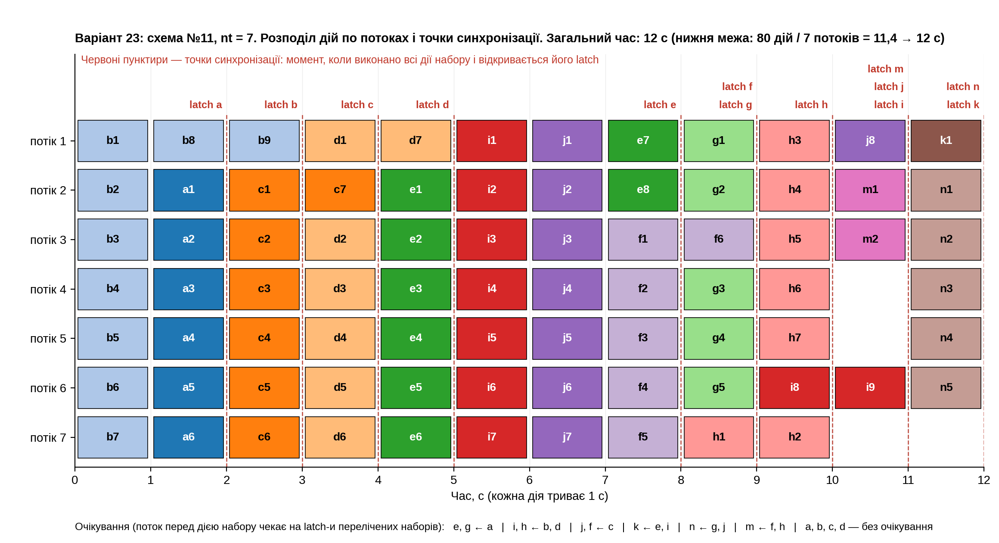
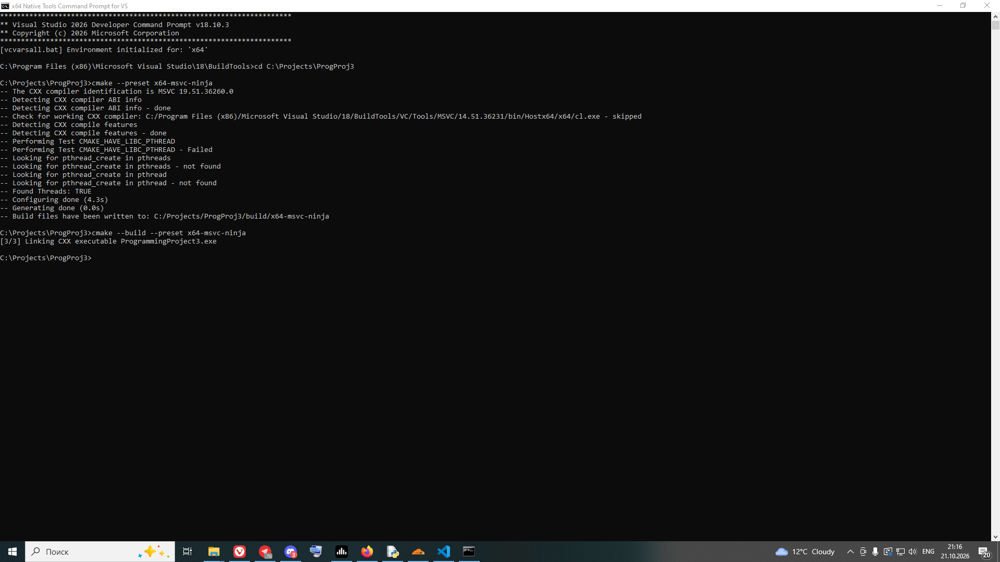
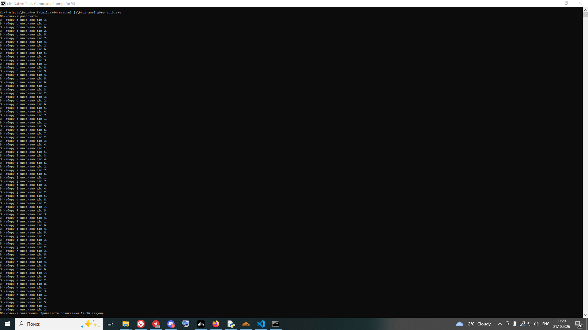

# Програмний проєкт №3

Виконання обчислення за схемою (орграф із мітками дуг) у `nt` потоках за мінімальний
загальний час. **Варіант 23:** схема №11, `nt = 7`, a=6, b=9, c=7, d=7, e=8, f=6, g=5,
h=7, i=9, j=8, k=1, m=2, n=5.

**Виконавець:** Корпачов Артем Андрійович (виконується одноосібно). Група К-27, 2 курс,
факультет комп'ютерних наук та кібернетики КНУ імені Тараса Шевченка, спеціальність F3
«Комп'ютерні науки», освітня програма «Інформатика». Дисципліна: «Програмування мовою
C++. Додаткові розділи».

## Умова

Кожна дуга схеми — набір дій; параметр з іменем дуги задає кількість дій у наборі. Дії
набору можна розпочинати лише тоді, коли виконано **всі** дії **усіх** наборів, що входять
у початковий вузол дуги. Дії одного набору між собою незалежні. Одну дію не можна ділити
між потоками. Крім потоку з `main` запускається рівно `nt` потоків; `main` дій не виконує.
Розподіл дій по потоках і порядок виконання задано жорстко (hardcoded). Дія `f(x, i)` —
заглушка: потік спить 1 секунду й виводить `З набору x виконано дію i.`

## Схема №11 як залежності

Вузли: джерела S0, S1, S2 → A, B, C → D, E, F → стік T.

| Набір | Дуга | Дій | Починається після завершення |
| --- | --- | --- | --- |
| `a` | S0 → A | 6 | — |
| `b` | S1 → B | 9 | — |
| `c` | S2 → C | 7 | — |
| `d` | S0 → B | 7 | — |
| `e` | A → D | 8 | `a` |
| `g` | A → E | 5 | `a` |
| `i` | B → D | 9 | `b`, `d` |
| `h` | B → F | 7 | `b`, `d` |
| `j` | C → E | 8 | `c` |
| `f` | C → F | 6 | `c` |
| `k` | D → T | 1 | `e`, `i` |
| `n` | E → T | 5 | `g`, `j` |
| `m` | F → T | 2 | `f`, `h` |

## Розв'язок

* Кожному набору відповідає **`std::latch`** з лічильником, що дорівнює кількості його
  дій. Потік, виконавши дію, робить `count_down()`; коли виконано всі дії набору, latch
  відкривається — це **точка синхронізації**.
* Перед дією потік викликає `wait()` на latch-ах наборів, від яких вона залежить
  (`SETS` у `src/schedule.h`). Решта координації не потрібна.
* Дії розподілено по потоках заздалегідь (`PLANS` у `src/schedule.h`); кожен потік
  виконує свій список по порядку. Список побудовано так, що жодна дія не стоїть перед тими,
  від кого залежить, тому взаємного блокування бути не може.
* Потоки — `std::jthread`, вивід — `std::osyncstream` (рядки різних потоків не змішуються).
  `semaphore` та `barrier` не потрібні.

### Чому час мінімальний

Усього дій: 6+9+7+7+8+6+5+7+9+8+1+2+5 = **80**. Семеро потоків за одну секунду виконують не
більше 7 дій, тому час не менший за 80/7 ≈ 11,4, тобто **не менше 12 с**. Розклад нижче
вкладається рівно в **12 с**, отже він оптимальний. Крім того, він «ненаситний»: у кожну
секунду виконується стільки дій, скільки доступно (не більше 7), тож потік не простоює,
поки є доступна дія, яку ще не розпочато. Розклад знайдено повним перебором і перевірено
моделюванням виконання (залежності, відсутність блокувань, завантаженість потоків).

| Секунда | Дії (набір × кількість) | Зайнято потоків |
| --- | --- | --- |
| 1 | `b` × 7 | 7 |
| 2 | `a` × 6, `b` × 1 | 7 |
| 3 | `b` × 1, `c` × 6 | 7 |
| 4 | `c` × 1, `d` × 6 | 7 |
| 5 | `d` × 1, `e` × 6 | 7 |
| 6 | `i` × 7 | 7 |
| 7 | `j` × 7 | 7 |
| 8 | `e` × 2, `f` × 5 | 7 |
| 9 | `f` × 1, `g` × 5, `h` × 1 | 7 |
| 10 | `h` × 6, `i` × 1 | 7 |
| 11 | `i` × 1, `j` × 1, `m` × 2 | 4 |
| 12 | `k` × 1, `n` × 5 | 6 |

## Діаграма

На діаграмі: рядок — потік, блок — дія (`b3` = третя дія набору `b`), червоні пунктири —
моменти, коли відкриваються latch-і наборів (точки синхронізації).



## Збирання

* C++23, MSVC 19.51.36260 (Visual Studio 2026 / Build Tools v18.10.3); використано
  `<thread>`, `<latch>`, `<syncstream>`.
* CMake 3.25+, Ninja, x64. Прапорець `/utf-8` потрібен, бо код і вивід містять кирилицю.

У **x64 Native Tools Command Prompt for VS 2026**:

```bat
cd C:\Projects\ProgProj3
cmake --preset x64-msvc-ninja
cmake --build --preset x64-msvc-ninja
```

## Запуск

```bat
build\x64-msvc-ninja\ProgrammingProject3.exe
build\x64-msvc-ninja\ProgrammingProject3.exe > results.txt
```

Вхідних даних немає. Програма сама переключає консоль Windows на UTF-8 і відновлює
кодову сторінку при виході. Для перенаправлення в файл використовуйте `cmd`
(Developer Command Prompt): у Windows PowerShell 5.1 оператор `>` зберігає файл
у UTF-16. Файл `results.txt` у UTF-8. Якщо він відкрився з «ієрогліфами», відкрийте його як UTF-8.

Приклад виводу (порядок рядків в межах однієї секунди може відрізнятися від запуску до запуску):

```text
Обчислення розпочато.
З набору b виконано дію 1.
З набору b виконано дію 7.
З набору b виконано дію 6.
...
З набору k виконано дію 1.
З набору n виконано дію 1.
Обчислення завершено. Тривалість обчислення 12.01 секунд.
```

## Скріншоти

Збирання:



Робота програми:



## Структура проєкту

```text
ProgProj3/
├── .gitignore
├── CMakeLists.txt
├── CMakePresets.json
├── README.md
├── diagram.png               діаграма розподілу по потоках і точок синхронізації
├── results.txt               вивід програми
├── screenshots/
│   ├── build.png             результат збирання
│   └── run.png               результат роботи програми
└── src/
    ├── main.cpp              запуск nt потоків, latch-і, вимірювання часу
    ├── schedule.h            схема (залежності) і жорстко задані плани потоків
    ├── work.h                оголошення заглушки f(x, i)
    └── work.cpp              заглушка f: сон 1 с і вивід через osyncstream
```
